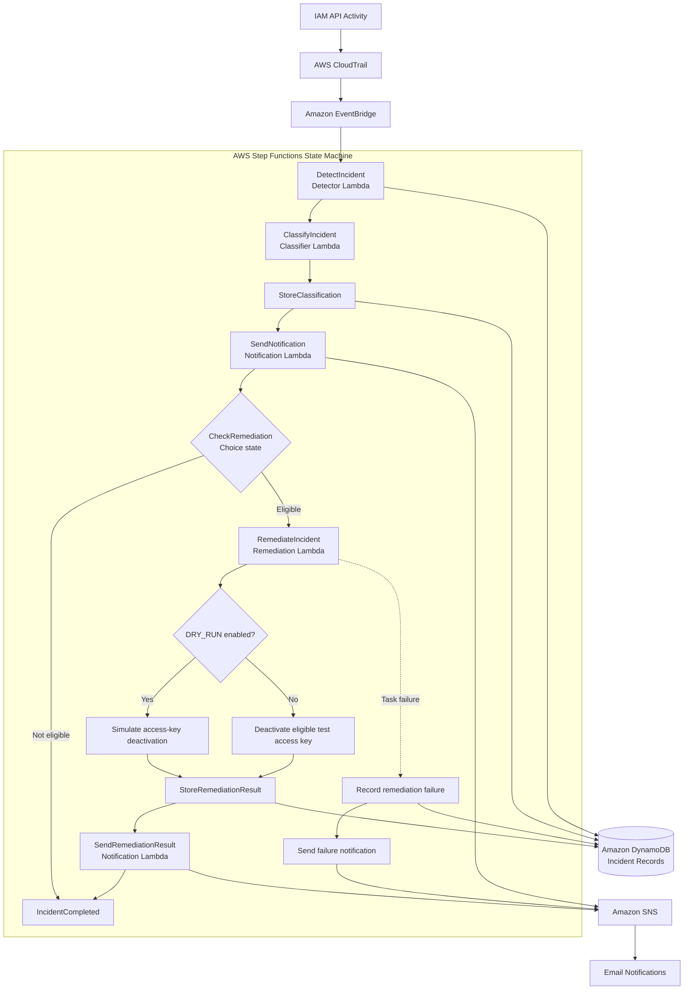

# Week 35 — AWS Automated Security Incident Response

An event-driven AWS security incident response system built with Terraform, AWS Lambda, Step Functions, EventBridge, DynamoDB, and SNS.

This project detects selected IAM API activity through AWS CloudTrail, creates and classifies security incidents, sends notifications, and evaluates whether an automated remediation action is appropriate.

The remediation workflow is designed with safety controls and currently operates in **DRY_RUN mode**. A real IAM access-key creation event was successfully processed through the remediation branch, and the system confirmed the proposed deactivation without changing the access key.

---

## Project Objectives

- Detect selected IAM API activity using AWS CloudTrail and Amazon EventBridge.
- Orchestrate incident processing using AWS Step Functions.
- Record security incidents and processing outcomes in Amazon DynamoDB.
- Classify incidents according to predefined severity rules.
- Send incident alerts and remediation results through Amazon SNS.
- Implement a controlled IAM access-key remediation handler.
- Apply least-privilege IAM permissions to individual Lambda functions.
- Provision and manage infrastructure using Terraform.

## Architecture

CloudTrail records IAM API activity, EventBridge filters selected events, and Step Functions coordinates the incident response process. The remediation decision is made by the `CheckRemediation` choice state after the initial alert is sent.



**Important:** The actual access-key deactivation path is implemented in the remediation handler but has not been tested with dry-run disabled. The verified test used the simulation path.

## AWS Services Used

| Service | Purpose |
|---|---|
| AWS CloudTrail | Records IAM API activity. |
| Amazon EventBridge | Detects selected IAM events and starts the workflow. |
| AWS Step Functions | Orchestrates incident detection, classification, notification, and remediation. |
| AWS Lambda | Executes the incident response logic. |
| Amazon DynamoDB | Stores incident records and remediation outcomes. |
| Amazon SNS | Sends incident and remediation notifications. |
| AWS IAM | Controls permissions for the individual components. |
| Terraform | Provisions and manages AWS infrastructure. |

## IAM Events Monitored

The EventBridge rule monitors the following IAM API events:

| Event | Description |
|---|---|
| `CreateUser` | An IAM user is created. |
| `DeleteUser` | An IAM user is deleted. |
| `CreateGroup` | An IAM group is created. |
| `DeleteGroup` | An IAM group is deleted. |
| `CreateAccessKey` | An IAM access key is created. |
| `DeleteAccessKey` | An IAM access key is deleted. |
| `AttachUserPolicy` | A managed policy is attached to a user. |
| `DetachUserPolicy` | A managed policy is detached from a user. |
| `PutUserPolicy` | An inline user policy is created or updated. |
| `DeleteUserPolicy` | An inline user policy is deleted. |
| `AddUserToGroup` | A user is added to a group. |
| `RemoveUserFromGroup` | A user is removed from a group. |

These are selected monitoring targets, not an exhaustive list of AWS security events.

## Incident Severity Classification

The classifier assigns severity based on the IAM event name.

| Severity | Events |
|---|---|
| HIGH | `CreateUser`, `CreateAccessKey`, `AttachUserPolicy`, `PutUserPolicy` |
| MEDIUM | `DeleteUser`, `DeleteGroup`, `DeleteAccessKey`, `DetachUserPolicy`, `DeleteUserPolicy`, `AddUserToGroup`, `RemoveUserFromGroup` |
| LOW | `CreateGroup` and events without a matching rule |

These are project-defined severity rules for demonstration purposes, not AWS-managed risk ratings.

## Step Functions Workflow

The Step Functions state machine coordinates the following stages:

1. **DetectIncident** — invokes the Incident Detector Lambda.
2. **ClassifyIncident** — invokes the Incident Classifier Lambda.
3. **StoreClassification** — updates the incident's severity and remediation status in DynamoDB.
4. **SendNotification** — sends the initial incident alert through SNS.
5. **CheckRemediation** — checks whether the classifier authorized remediation.
6. **RemediateIncident** — invokes the Remediation Handler Lambda when eligible.
7. **StoreRemediationResult** — records the remediation outcome in DynamoDB.
8. **SendRemediationResult** — sends a follow-up notification.
9. **IncidentCompleted** — completes the workflow.

The state machine also includes a failure-handling path. If the remediation task fails, the workflow records the failure in DynamoDB and sends a failure notification.

## Lambda Functions

### 1. Incident Detector

**Function:** `week35-incident-response-detector`

Responsibilities:

- Receives the CloudTrail event from Step Functions.
- Extracts relevant event information.
- Generates a unique incident ID.
- Adds processing metadata and an initial status.
- Stores the incident in DynamoDB.

### 2. Incident Classifier

**Function:** `week35-incident-response-classifier`

Responsibilities:

- Evaluates the IAM event name.
- Assigns a severity level.
- Checks whether the event meets the project's remediation eligibility conditions.
- Returns the classification and remediation decision to Step Functions.

The current remediation eligibility rule requires:

- The event must be `CreateAccessKey`.
- The IAM username must match `week35-remediation-test-user`.
- An access key ID must be present in the CloudTrail response elements.

### 3. Notification Handler

**Function:** `week35-incident-response-notification`

Responsibilities:

- Sends the initial incident alert.
- Sends remediation result notifications.
- Sends remediation failure notifications.
- Includes incident details, severity, region, and remediation outcome.

### 4. Remediation Handler

**Function:** `week35-incident-response-remediation`

Responsibilities:

- Validates the event type.
- Checks that the IAM username matches the designated test user.
- Checks for an access key ID.
- Confirms that the classifier authorized remediation.
- Evaluates whether the action should be simulated or executed.

The intended remediation action is to deactivate an eligible IAM access key using:

`iam:UpdateAccessKey`

**Safety setting:** `DRY_RUN=true`

When dry-run is enabled, the handler reports the proposed deactivation without changing the IAM access key.

The dry-run branch has been successfully tested using a real CloudTrail `CreateAccessKey` event.

## DynamoDB Incident Records

**Table:** `week35-incident-response-incidents`

**Billing mode:** PAY_PER_REQUEST

**Partition key:** `incident_id`

The detector initially stores incident information including:

- `incident_id`
- `event_name`
- `event_source`
- `event_time`
- `account`
- `region`
- `status`
- `severity`
- `remediation_status`
- `details`

The workflow subsequently updates top-level attributes such as severity and remediation status.

The `details` attribute contains a JSON snapshot of the original incident captured by the detector. It is not automatically rewritten when Step Functions updates the top-level attributes. The top-level attributes therefore represent the latest workflow outcome, while `details` preserves the initial incident snapshot.

## IAM Security and Permissions

The project uses separate execution roles for the Lambda functions rather than granting every function the same permissions.

| Role | Intended permissions |
|---|---|
| Detector role | Write incident records to the DynamoDB table. |
| Classifier role | Lambda execution and logging permissions. |
| Notification role | Publish messages to the SNS topic. |
| Remediation role | Update access keys for the designated test IAM user only. |
| Step Functions role | Invoke the four workflow Lambda functions and update incident records. |
| EventBridge role | Start executions of the Step Functions state machine. |

The remediation role's `iam:UpdateAccessKey` permission is scoped to the designated test user's IAM ARN rather than all IAM users. This separation helps limit the impact of a compromised or misconfigured component.


## Development environment:

| Component | Version / Configuration |
|---|---|
| AWS Region | `us-east-1` |
| Terraform | `1.15.2` |
| AWS Provider | `~> 6.0` |
| Lambda Runtime | Python 3.12 |

## Configuration

The project uses Terraform variables for configuration.

| Variable | Purpose |
|---|---|
| `aws_region` | AWS deployment region. |
| `project_name` | Resource naming prefix. |
| `environment` | Deployment environment. |
| `notification_email` | SNS notification email address. |
| `remediation_test_username` | Dedicated test IAM username. |
| `remediation_dry_run` | Controls whether remediation is simulated. |

Keep environment-specific values in a local `terraform.tfvars` file. Do not commit this file or AWS credentials to GitHub.

## Deployment

Clone the repository and enter the project directory:

```bash
git clone <your-repository-url>
cd week35-aws-automated-incident-response
```

Initialize Terraform:

```bash
terraform init
```

Validate the configuration:

```bash
terraform validate
```

Review the proposed infrastructure changes:

```bash
terraform plan
```

Apply the configuration:

```bash
terraform apply
```

Review the plan carefully before approving infrastructure changes. After deployment, confirm the SNS email subscription using the confirmation link sent to the configured email address.

## Validation and Testing

The project was tested using both synthetic events and real IAM API activity.

### Validation Summary

| Test | Result |
|---|---|
| Terraform infrastructure deployment | Successful |
| Detector Lambda direct invocation | Successful |
| Synthetic `CreateGroup` workflow execution | Successful |
| DynamoDB incident record creation | Verified |
| DynamoDB classification updates | Verified |
| Initial SNS notification | Received |
| Real IAM `CreateGroup` event through EventBridge | Successful |
| Real `CreateAccessKey` event through CloudTrail | Successful |
| EventBridge-to-Step-Functions trigger | Verified |
| Classifier null-safe code update | Syntax validated and deployed |
| Remediation handler null-safe code update | Syntax validated and deployed |
| Remediation branch execution | Successful |
| Dry-run remediation result | `DRY_RUN` verified |
| Access key after dry-run | Remained `Active` |
| Follow-up remediation result notification | Received |
| Actual IAM access-key deactivation | Not tested; dry-run remains enabled |

### Real Access-Key Dry-Run Test

A dedicated IAM test user was created:

`week35-remediation-test-user`

One access key was created for this user to generate a real CloudTrail management event.

The CloudTrail event contained:

- `eventName`: `CreateAccessKey`
- `requestParameters.userName`: `week35-remediation-test-user`
- `responseElements.accessKey.accessKeyId`: Present
- `responseElements.accessKey.status`: `Active`

This confirmed that the actual CloudTrail payload contained the fields required by the classifier.

EventBridge detected the event and started the Step Functions execution approximately three seconds after the access key was created.

The workflow completed successfully and entered all of the following states:

- `DetectIncident`
- `ClassifyIncident`
- `StoreClassification`
- `SendNotification`
- `RemediateIncident`
- `StoreRemediationResult`
- `SendRemediationResult`

The final Step Functions execution output confirmed:

```json
{
  "event_name": "CreateAccessKey",
  "severity": "HIGH",
  "remediation_required": true,
  "remediation_status": "DRY_RUN",
  "remediation_action": "DeactivateAccessKey",
  "remediation_reason": "Dry-run mode; no IAM changes were made"
}
```

The IAM access-key status was checked after execution and remained `Active`. This confirms that the remediation handler evaluated the real access-key event and simulated the deactivation without modifying the IAM resource.

A follow-up email titled `[HIGH] AWS Incident Remediation Result` was received. It reported the incident ID, event name, severity, remediation status `DRY_RUN`, the proposed action `DeactivateAccessKey`, and the reason "Dry-run mode; no IAM changes were made."

**Test conclusion:** The complete incident detection, classification, notification, and remediation dry-run workflow was successfully verified using a real IAM API event. The actual deactivation path remains untested.

## Challenges and Troubleshooting

### 1. Step Functions execution failed during classifier invocation

**Problem**

The initial workflow execution failed with:

```text
NameError: name 'k' is not defined
File "/var/task/app.py", line 1
```

**Cause**

The deployed classifier source contained an unintended standalone `k` on the first line of the Python file.

The initial investigation focused on the Detector Lambda because it was the first task in the workflow. Direct invocation of the detector confirmed that it was working correctly.

**Resolution**

- Inspected the classifier source file.
- Identified and removed the unintended character.
- Revalidated the Python file using `py_compile`.
- Rebuilt the Lambda ZIP package.
- Redeployed the classifier.
- Waited for AWS to confirm the deployment was successful.
- Executed the workflow again.

The subsequent synthetic workflow execution completed successfully.

### 2. Defensive handling of null values in event payloads

**Risk**

The Lambda handlers originally retrieved nested event objects using:

```python
request_parameters = event.get("request_parameters", {})
response_elements = event.get("response_elements", {})
```

**Cause**

The default `{}` only applies when the key is missing. If the key exists but its value is `None`, subsequent dictionary operations on that value can fail.

**Resolution**

Updated the code to use:

```python
request_parameters = event.get("request_parameters") or {}
response_elements = event.get("response_elements") or {}
```

The same defensive handling was applied to the remediation handler's nested event objects. Both Lambda files passed Python syntax validation and were packaged and deployed.

### 3. Distinguishing successful workflow execution from successful remediation

**Problem**

A Step Functions execution can report `SUCCEEDED` without proving that the remediation action was actually evaluated or executed.

**Cause**

A successful workflow status only confirms that the state machine completed its configured path. It does not establish which remediation branch ran or what action the handler returned.

**Resolution**

Inspected the execution history to confirm that the workflow entered:

- `RemediateIncident`
- `StoreRemediationResult`
- `SendRemediationResult`

Then inspected the final execution output and confirmed:

```text
remediation_status = DRY_RUN
remediation_required = true
remediation_action = DeactivateAccessKey
```

Finally, checked the IAM access-key status and confirmed it remained `Active`. This provided evidence of the actual remediation result rather than relying solely on the execution status.

### 4. CloudTrail response payload verification

**Problem**

The classifier depends on the access key ID being present in the CloudTrail response elements.

**Cause**

It is unsafe to assume that every CloudTrail event contains every expected response field. A missing field would prevent the remediation eligibility check from passing.

**Resolution**

Created a real access key for the dedicated test IAM user and inspected the corresponding CloudTrail event using `lookup-events`.

The actual event contained the following structure:

```json
{
  "requestParameters": {
    "userName": "week35-remediation-test-user"
  },
  "responseElements": {
    "accessKey": {
      "userName": "week35-remediation-test-user",
      "accessKeyId": "<REDACTED>",
      "status": "Active"
    }
  }
}
```

The `accessKeyId` value is redacted here. The real event contained the key ID, which confirmed that the classifier's required fields were available for this test.

## Lessons Learned

### 1. Validate each component before blaming the workflow

The first Step Functions failure appeared during a multi-stage execution. It would have been easy to assume that the first Lambda was responsible.

Directly invoking the Detector Lambda helped isolate the problem. Inspecting execution history and CloudWatch logs then identified the actual failure in the Classifier Lambda.

**Lesson:** Debug distributed workflows one component at a time. Verify the failing task instead of assuming the first task is responsible.

### 2. Synthetic events are not a substitute for real event validation

Synthetic events are useful for testing application logic, but they may not accurately represent the structure of actual CloudTrail events.

The real `CreateAccessKey` event provided the evidence needed to confirm that `requestParameters.userName` and `responseElements.accessKey.accessKeyId` were available.

**Lesson:** Use synthetic events for controlled development, then validate critical assumptions against real service-generated events.

### 3. Successful execution does not necessarily mean successful remediation

The remediation branch needed to be inspected separately from the overall Step Functions status.

The execution history confirmed that the remediation states ran, while the final execution output established that the handler returned `DRY_RUN`.

**Lesson:** Verify the business outcome of a workflow, not just whether the orchestration engine reports success.

### 4. Safety controls should be part of the remediation design

Automated incident response can affect access and availability. A mistaken remediation decision could disrupt legitimate operations.

The dedicated test IAM user, exact username validation, scoped IAM permission, classifier authorization, and dry-run setting provided multiple layers of control.

**Lesson:** Validate remediation eligibility and simulate the action before allowing automated changes to IAM resources.

### 5. DynamoDB snapshots and workflow updates serve different purposes

The detector stores the initial incident details as a JSON snapshot. Step Functions subsequently updates selected top-level DynamoDB attributes.

**Lesson:** Be explicit about which fields represent the initial event and which fields represent the latest workflow outcome.

## Screenshots

Sensitive values such as account IDs, email addresses, and unsubscribe links are redacted.

### EventBridge rule and monitored IAM events

***

### Step Functions state machine

***

### DynamoDB incident record

***

### Initial SNS alert

***

### Remediation execution history

***

### Dry-run execution output

***

### Access key still active after dry-run

***

### Remediation result email

***

## Security Considerations

- Keep remediation in dry-run mode until the complete execution path has been reviewed and approved.
- Use a dedicated test IAM user rather than a production identity.
- Never commit AWS access keys, secret keys, or credentials to GitHub.
- Never commit local Terraform state or sensitive variable files.
- Keep Lambda execution roles scoped to the permissions each function needs.
- Review CloudTrail events and remediation outcomes during testing.
- Review Terraform plans before applying changes.
- Treat this project as a learning and portfolio environment, not a production-ready security response platform.

## Cost Considerations

AWS services used in this project may incur charges, including:

- CloudTrail management and data event charges where applicable.
- EventBridge events.
- Step Functions state transitions.
- Lambda invocations and execution duration.
- DynamoDB storage and requests.
- SNS notifications.
- CloudWatch Logs storage.
- Other resources provisioned by Terraform.

Charges depend on usage, region, and current AWS pricing. Review AWS pricing and your billing dashboard before leaving resources running.

## Future Improvements

- Add additional security event categories and classification rules.
- Add richer incident context and investigation metadata.
- Implement automated unit tests for classifier and remediation edge cases.
- Introduce an approval mechanism before executing sensitive remediation actions.
- Improve remediation handling for events where expected response fields are unavailable.
- Add stronger operational monitoring and alerting for failed workflow executions.
- Evaluate production-grade safeguards before allowing automated IAM changes.

## Next Project

**Week 36 — AWS Security Monitoring and Incident Investigation Dashboard**

Week 36 builds on the incident records this project produces. Where Week 35 detects, classifies, alerts, and evaluates remediation for individual events, Week 36 makes that data easier to monitor and investigate over time.

Planned work:

- A centralized view of incident severity and status
- CloudWatch metrics and alarms for incident volume and failed executions
- Security event trends and reporting
- Improved investigation context and audit history

This moves the project from responding to individual security events toward monitoring and investigating security activity as a whole.
